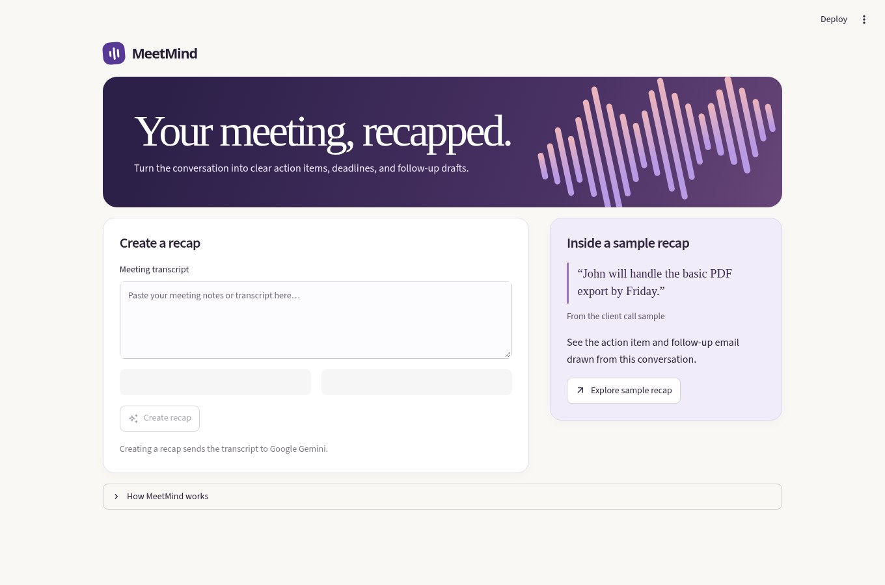

# MeetMind

A Streamlit workspace for turning a meeting transcript into action items, open questions, editable follow-up emails, and a downloadable Markdown recap.



[Open the hosted app](https://meet-mind.streamlit.app/)

## Run locally

```sh
python -m venv .venv
source .venv/bin/activate
python -m pip install -r requirements.txt
python -m streamlit run app.py
```

Choose **Explore sample recap** to explore a prepared client call without credentials. For live analysis, set `GEMINI_API_KEY` in the environment, a local `.env` file, or top-level Streamlit Cloud secrets. Set `GEMINI_MODEL` to override the default `gemini-flash-latest`.

## Workflow

1. Paste a transcript or load one of the three samples. Choose the meeting type.
2. Select **Create recap** to send the transcript to Gemini. MeetMind validates the extracted notes, drafts follow-ups for named owners, and asks Gemini to score the meeting.
3. Review the action items, open questions, and scores. Edit subjects and messages in **Follow-up emails**, then download the recap. Drafts stay in the current Streamlit session.

Built by Rohit Kumbhar.
